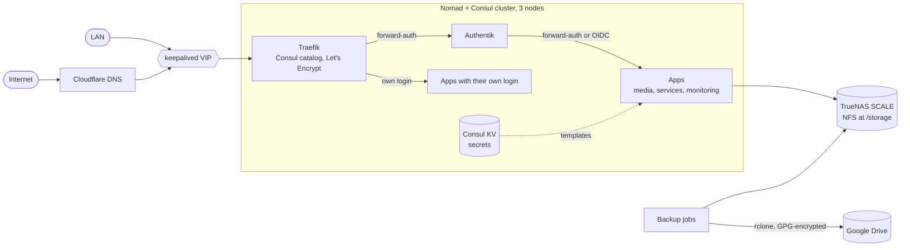

# Homelab

Configuration for my homelab: a three-node Nomad and Consul cluster, a TrueNAS SCALE NAS for storage, Traefik for ingress and Authentik for single sign-on. Everything is declared in this repo: hosts with Ansible, workloads as Nomad jobs, SSO apps as Authentik blueprints.

Secrets are never committed. They live in Consul KV and Nomad templates read them at runtime.

## Architecture



- Three Dell OptiPlex nodes, each a Nomad server+client and a Consul server.
- TrueNAS SCALE provides NFS storage, mounted at `/storage` on every node.
- Traefik discovers routes from Consul catalog tags. Certificates come from Let's Encrypt using the Cloudflare DNS challenge. keepalived holds a virtual IP so ingress survives a node loss.
- Authentik protects apps either with forward-auth (Traefik middleware `authentik@consulcatalog`) or native OIDC where the app supports it. Some apps keep their own login on purpose.
- Images are pinned to exact versions and bumped by Renovate.

## Repo layout

| Path | What |
|---|---|
| `ansible/` | Rebuilds the three hosts (packages, network, NFS mount, Docker, CNI, Consul, Nomad). See `ansible/README.md`. |
| `nomad/jobs/<category>/` | Nomad job specs: `ingress`, `media`, `monitoring`, `security`, `services`, `websites`. |
| `nomad/jobs/backups/` | Periodic backup jobs, one per stateful app, plus the cluster snapshot job. |
| `nomad/jobs/services/authentik/` | Authentik job and `blueprints/` (one YAML per app: provider, application, icon, group). |
| `nomad/scripts/` | `kv-check.sh`, which lists and verifies the Consul KV keys the jobs need. |
| `.github/` | CI workflow. |
| `.pre-commit-config.yaml` | Local and CI checks. |
| `renovate.json` | Dependency update policy. |

## Apps

Auth column: **SSO forward-auth** (Traefik middleware, app unaware), **SSO OIDC** (native), **own login** (the app's built-in auth, by choice) or **none**.

### Ingress

| App | What | Auth |
|---|---|---|
| Traefik | Reverse proxy, TLS | own login |
| keepalived | Virtual IP for ingress | none |

### Media

| App | What | Auth |
|---|---|---|
| Jellyfin | Media server | SSO OIDC |
| Seerr | Media requests | SSO OIDC |
| Sonarr | TV management | SSO forward-auth |
| Radarr | Movie management | SSO forward-auth |
| Bazarr | Subtitles | SSO forward-auth |
| Prowlarr | Indexer manager | SSO forward-auth |
| Tracearr | Media server activity tracking | SSO forward-auth |
| qBittorrent | Torrent client | own login |
| Transmission | Torrent client | own login |

### Services

| App | What | Auth |
|---|---|---|
| Authentik | Identity provider | own login |
| Homarr | Dashboard | SSO OIDC |
| HedgeDoc | Collaborative markdown | SSO OIDC |
| Reactive Resume | Resume builder | SSO OIDC |
| Vaultwarden | Password manager | SSO OIDC (own login kept for the vault) |
| ArchiSteamFarm | Steam card farming | SSO forward-auth |
| Your LastFM | Last.fm stats | SSO forward-auth |
| Plausible | Web analytics | own login |
| Stirling PDF | PDF tools | none |
| FlareSolverr | Cloudflare challenge solver for indexers | none |
| Homebridge | HomeKit bridge | own login |
| Cloudflare DDNS | Keeps DNS records current | none |

### Monitoring

| App | What | Auth |
|---|---|---|
| Prometheus | Metrics | SSO forward-auth |
| Grafana | Dashboards | SSO OIDC |
| Loki | Logs | none (internal) |
| Grafana Alloy | Log and metric shipping | none (internal) |
| Node exporter | Host metrics | none (internal) |
| Gatus | Status page and endpoint checks | own login |
| Uptime Kuma | Uptime monitoring | own login |
| Dozzle | Container logs | SSO forward-auth |
| Diun | Image update notifications | none |
| Netronome | Network speed tests | SSO OIDC |
| WatchYourLAN | LAN device scanner | SSO forward-auth |

### Security

| App | What | Auth |
|---|---|---|
| Dependency-Track | SBOM and vulnerability tracking | SSO OIDC |
| Trivy server | Image scanning backend | none |
| cve-scan | Periodic image scan job | none |

### Websites

| App | What | Auth |
|---|---|---|
| homelab-docs | Private homelab documentation site | SSO forward-auth |

## How to

### Rebuild a node

Hosts are managed with Ansible, one at a time to keep Consul and Nomad quorum.

```sh
cd ansible
ansible-galaxy collection install -r requirements.yml
ansible-playbook site.yml --check --diff     # preview, expect zero changes on healthy hosts
ansible-playbook site.yml --diff -l <host>   # apply (play runs serial: 1)
```

Details, roles and quorum notes are in `ansible/README.md`.

### Deploy a job

Run from `nomad/`, because some jobs (Authentik) load blueprints with `fileset()` and paths are relative to it.

```sh
cd nomad
nomad job run jobs/media/jellyfin.hcl
nomad job run jobs/services/authentik/authentik.hcl
```

### Add a new app

1. Create `nomad/jobs/<category>/<app>.hcl`.
2. Follow the conventions used by existing jobs:
   - `app` group first, then a `db` group when the app needs a database.
   - Database: `postgres:17-alpine`, and the app waits for it with a `wait-for-db` task.
   - Env templates with aligned `KEY = value` lines, written with perms `0600` and `error_on_missing_key = true`.
   - `TZ` set to `Europe/Dublin`.
   - Both `memory` and `memory_max` set.
   - Image pinned to an exact version (no `latest`).
3. Add any new Consul KV keys, then run `nomad/scripts/kv-check.sh --check`.
4. Add `nomad/jobs/backups/<app>-backup.hcl` if the app has state.
5. Add a Gatus endpoint for it.
6. Add `nomad/jobs/services/authentik/blueprints/app-<app>.yaml` with `meta_icon` (from dashboard-icons), the group (matching the category) and `open_in_new_tab`. Use forward-auth (add `authentik@consulcatalog` to the router middlewares) or OIDC, depending on app support.
7. `nomad fmt`, `pre-commit run --all-files`, then deploy.

### Secrets

Secrets and per-environment values live in Consul KV. Jobs read them with `key` and `keyOrDefault` in templates. `nomad/scripts/kv-check.sh` lists the key names per job (names only, never values).

```sh
nomad/scripts/kv-check.sh              # keys referenced per job
nomad/scripts/kv-check.sh --check      # verify every key exists in Consul (values never read)
nomad/scripts/kv-check.sh --markdown   # print the per-job key list as markdown
```

### Backups and restore

- App databases: per-app jobs in `nomad/jobs/backups/` dump the database, GPG-encrypt it and upload it to Google Drive with rclone, keeping `backup/retention/days` of history.
- Cluster state: `cluster-snapshot-backup` takes daily Consul and Nomad snapshots, encrypts them with a public key and writes `.gpg` files to NFS. The private key never lives on the cluster. Decrypt and restore steps are in `nomad/jobs/backups/README-cluster-snapshots.md`.

## Updates and CI

- Renovate (`renovate.json`) bumps pinned images and GitHub Actions. Patch updates auto-merge after 3 days, minor after 7 days. Majors and minors of critical apps (Authentik, Traefik, Vaultwarden, Jellyfin DB image) need a manual merge. Database major upgrades are disabled because they need a dump and restore.
- CI (`.github/workflows/ci.yml`) runs pre-commit (formatting, gitleaks secret scan, ansible-lint, `nomad fmt`), validates every Nomad job against a throwaway dev agent, and lints and syntax-checks the Ansible.
- Planned: self-hosted Renovate and pull-based auto-deploy of merged changes.

## Development

```sh
brew install pre-commit nomad
pre-commit install
pre-commit run --all-files
```

## License and contributing

Personal setup, shared for reference. Issues and suggestions are welcome.
